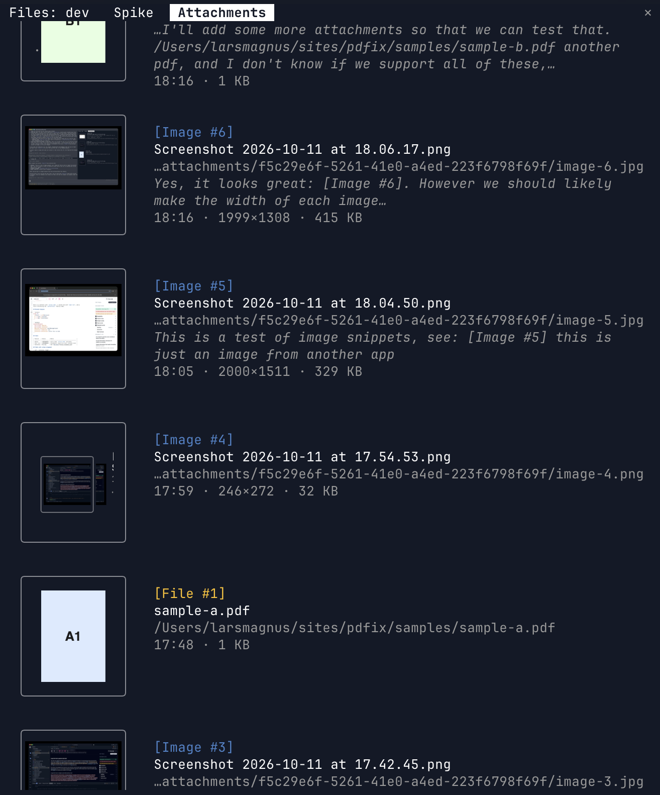

# attachments

See a full list of attachments added to a session. Includes thumbnail previews, links to the file, metadata, and a snippet of the context where you added the file.



Archives every image pasted or dropped into a session's main conversation, and every existing file whose absolute path a prompt contains. A dropped PDF or other non-image file reaches Claude only as its path, so that path is what gets listed. The `Attachments` pane lists them newest first. It opens on the first attachment of a session, and `/attachments` opens it on demand. Subagent conversations are ignored.

## Requirements

macOS. `sips` makes the PNG thumbnails, renders a PDF's first page, and reads image dimensions. `base64 -D` decodes pasted images. Thumbnails need a terminal with the kitty graphics protocol (Ghostty, kitty). Elsewhere each entry shows a text placeholder. Without `sips`, entries still list, just without thumbnails or dimensions.

## Install

```sh
claude plugin marketplace add ~/sites/dev/.claude/mods
claude plugin install attachments@larsmagnus --scope user
```

Edits apply with `/reload-plugins`. No reinstall needed.

## Pane

Each entry shows a thumbnail, then its ref (coloured by kind), filename, path, the prompt text around where it was attached, and time added, dimensions (images only) and size. Clicking the thumbnail opens the file in its default app, or reveals it in Finder when no app takes it. A file with no thumbnail shows its extension, as in `.txt file`, and clicks the same way. The filename and path are `file://` links, which Ghostty answers by revealing the file in Finder. The thumbnail frame lights on hover. The pane scrolls when the list outgrows it.

## Refs

`[Image #n]` is the engine's ref, and Claude sees it beside the image. Files get `[File #n]`, numbered by the mod. A media block without an inline ref gets `[Attachment #n]`.

Clicking a ref inserts `<ref> (<path>) ` at the prompt cursor. Compaction can drop an image from context, but the path lets Claude still Read the file.

A dropped image takes its original filename from the `[Image: source: <path>]` row the engine appends after the prompt. Pastes have no such row.

## Storage

Pasted images are decoded to `~/.claude/attachments/<sessionId>/`, as in `image-3-d0b5d374.jpg`. A pasted image exists only as base64 in the transcript, so decoding it is what makes it openable from the pane. The suffix is the start of the prompt's message id: a ref is only a label and can repeat, for example if a resumed session numbers images again, so an entry is known by its path instead. Archive folders are kept forever.

Dropped files stay where they are. Only a thumbnail is written to the archive folder, so an entry breaks if its file moves. `index.json` in each folder restores the list on resume.

## Engine constraints

The engine imposes these. They shape the code, so don't "fix" them.

- A plugin has one hooks module. Here it is `hooks/register.tsx`.
- Anything that touches `$` or a state atom must live in that module, in top-level functions. `$` cannot be passed into an imported function.
- `register.tsx` sits over the repo's complexity cap, knowingly, as agent-dock does. Pure logic lives in the other files.
- An `Image` takes no press, and a `Button` holds only text. So an invisible `Client` (`hooks/thumb-hit.tsx`) lies over each thumbnail. Drawing anything inside it covers the picture. Found by a spike.
- A `Box` hover restyles only a border it already has. So the frame is always drawn, dimmed, and lights on hover.
- The terminal `Image` reads only PNG from a file, hence `sips` thumbnails.

## Tests

```sh
claude plugin test .
```
