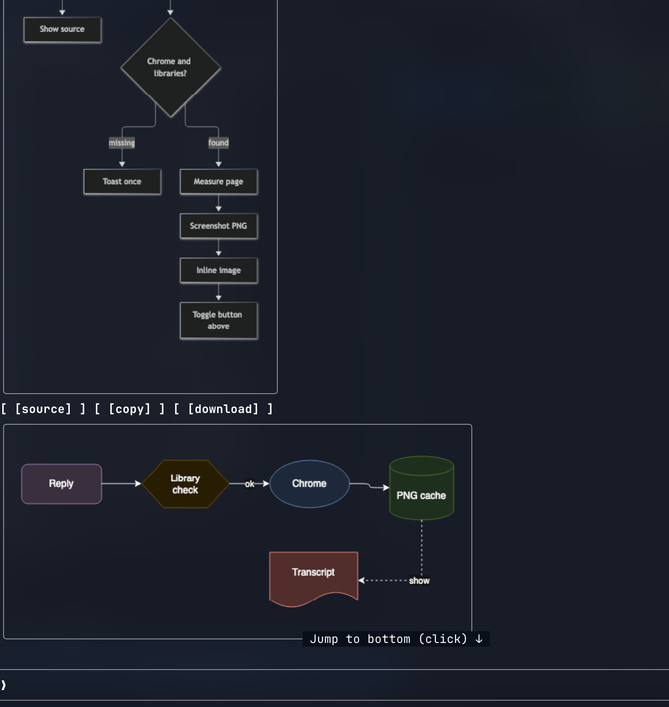

# diagrams

Mermaid and drawio code blocks in Claude's replies, drawn as pictures inline in the transcript.



A `[source]` button under each picture swaps it for the code block, `[diagram]` swaps back. `ctrl+o` always shows the original reply.

## Requirements

- A terminal that draws images: kitty, Ghostty, or iTerm2 3.5+. Elsewhere the code block stays as written.
- A Chromium-based browser in `/Applications` (Chrome, Chromium, Brave or Edge), or `chromePath` set in `/config`.

## Install

```sh
claude plugin marketplace add larsmagnus/dev
claude plugin install diagrams@larsmagnus --scope user
```

Then run `/diagrams:install` once.

## Updating

Enable auto-update for `larsmagnus` in `/plugin`.

### Manually updating

```sh
claude plugin marketplace update larsmagnus
```

Remember to run `/reload-plugins` after manually updating.

## Supported blocks

- ` ```mermaid ` - every diagram type mermaid supports.
- ` ```drawio ` - raw `mxGraphModel` XML, compressed or not.

## Why headless Chrome

Mermaid and drawio are browser libraries, and the terminal's `Image` takes a PNG. Both run in the Chrome you already have, loaded from the downloaded libraries. Text-art renderers need no browser, but cover few diagram types and no drawio.

## Why a block can stay as source

A block stays as written while it is still streaming, when it fails to draw, when there is no browser, and on a terminal without images. A failure is logged with `$.ui.log` and not retried.

## Drawing

Runs are queued, since Chrome locks its profile folder. Chrome sometimes dumps before the page has finished, so measuring retries. Each diagram is drawn once per session into `~/.claude/diagrams`; a session start deletes profiles idle for a day and pictures older than a month.

Both follow the `theme` option, on a transparent background.

## Libraries

mermaid (MIT) and the drawio viewer (Apache-2.0) are browser builds too large to keep in git. The `diagrams:install` skill downloads pinned versions into `~/.claude/diagrams/library` and checks their checksums. Chrome loads them from disk, so drawing works offline afterwards. The mod only warns when they are missing.

## Engine constraints

The engine imposes these. They shape the code, so don't "fix" them.

- A plugin has exactly one hooks module.
- A rewrite of `AssistantMessage` changes only the drawing. The stored reply is untouched.
- `Image` reads a PNG file the terminal opens itself, so the picture is a file on disk.
- The reply's drawing hook has no terminal width, so pictures are capped at a fixed column count.

## Tests

```sh
claude plugin test .
```
