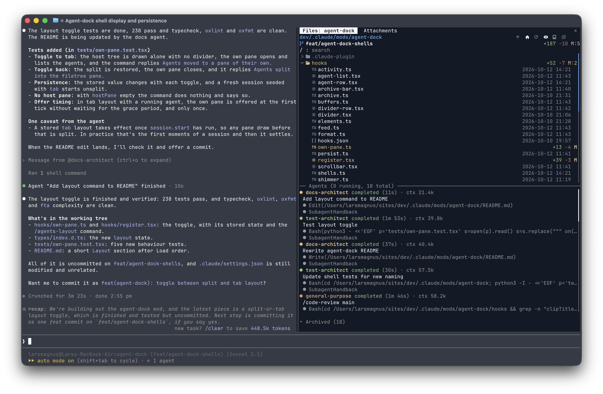
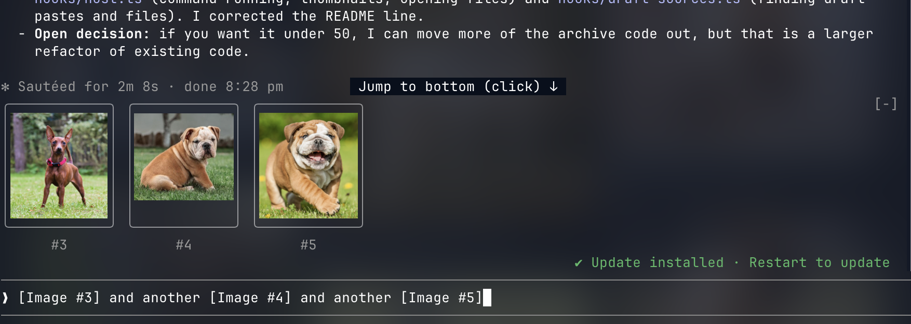
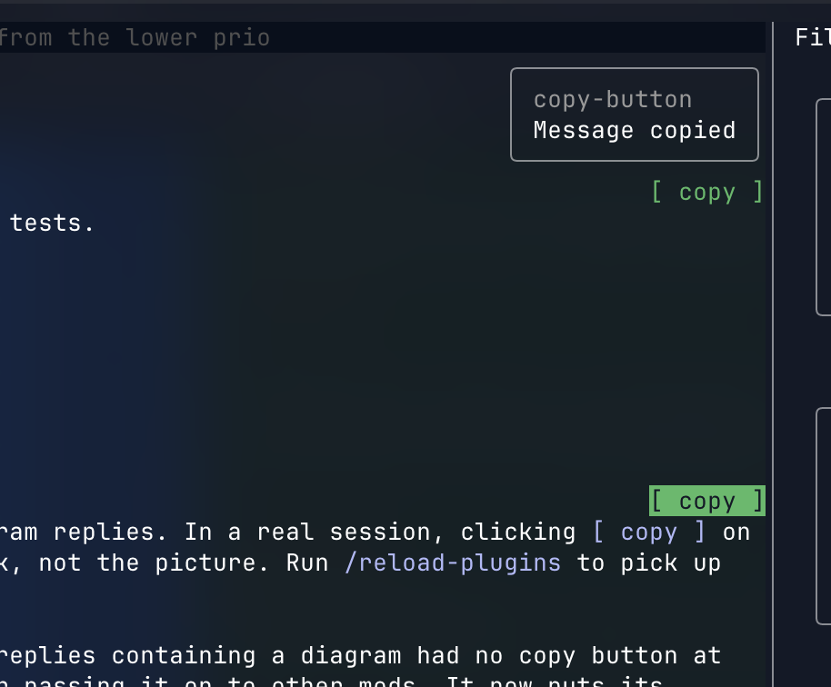
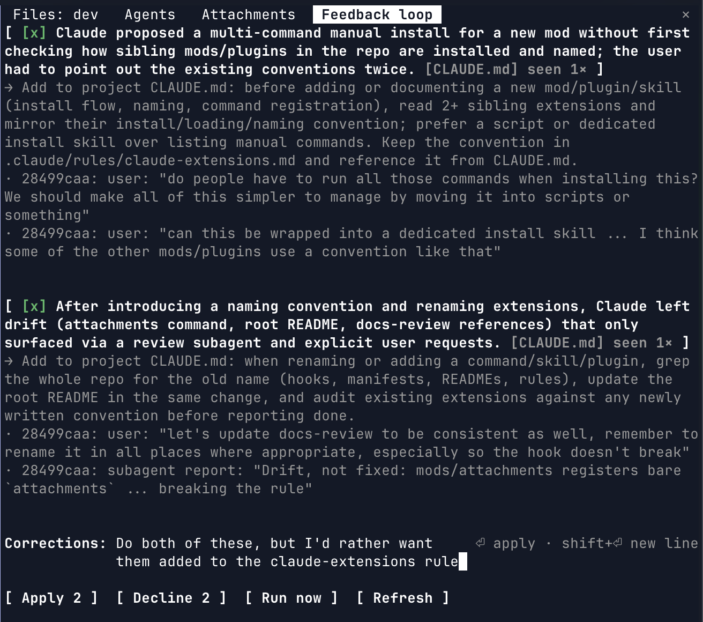
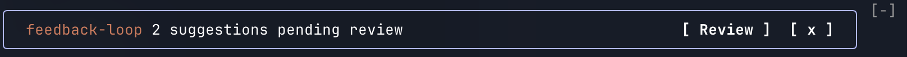
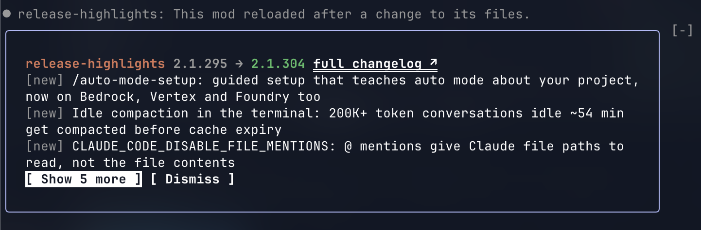
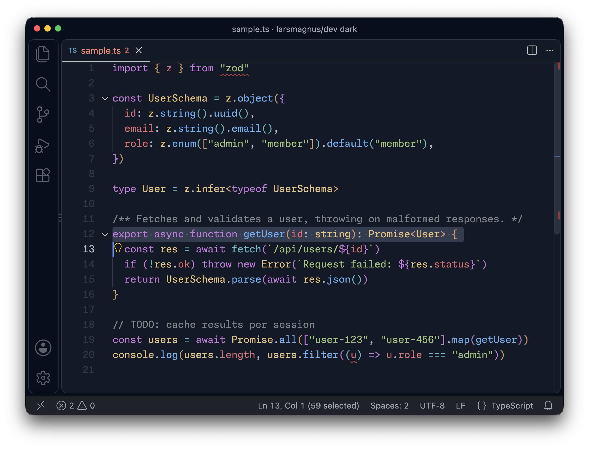

<div align="left">
  
</div>

# larsmagnus/dev

Dev setup, tooling, themes and productivity workflows.

## Packages

- [`root`](./packages/root/) - root config, including terminal and shell setup
- [`scripts`](./packages/scripts/) - dev setup, config and productivity scripts
- [`vscode`](./packages/vscode/) - vscode settings, keybindings, extensions and the larsmagnus/dev dark theme
- [`obsidian`](./packages/obsidian/) - obsidian config, templates and theming

## Claude Code

The setup I use every day for work.

### Install

```sh
claude plugin marketplace add larsmagnus/dev
claude plugin install agent-dock@larsmagnus
claude plugin install attachments@larsmagnus
claude plugin install copy-button@larsmagnus
claude plugin install diagrams@larsmagnus
claude plugin install feedback-loop@larsmagnus
claude plugin install release-highlights@larsmagnus
claude plugin install code-quality@larsmagnus
claude plugin install docs-review@larsmagnus
```

Requires Node 22.18 or newer.

Run `/feedback-loop:install` to enable the weekly background review.

### Updating

The plugins are not versioned. Every commit on main counts as a new version.

Enable auto-update for `larsmagnus` in `/plugin`.

#### Manually updating

```
claude plugin marketplace update larsmagnus
```

Remember to run `/reload-plugins` after manually updating.

### Settings

- [settings.json](.claude/settings.json) - Guardrails for secrets and sensible defaults

### Hooks

Do as much deterministic work as possible with hooks.

- [code-quality](.claude/plugins/code-quality/README.md) - Format, complexity and duplication checks after every edit
- [docs-review](.claude/plugins/docs-review/README.md) - Flag new inline comments for docs-architect review against CLAUDE.md

### Rules

Prefer deterministic work in hooks, linting and formatting before rules.

- [claude-extensions](.claude/rules/claude-extensions.md) - Command naming, sibling conventions and rename propagation for skills, plugins and mods
- [react-quality](.claude/rules/react-quality.md) - Fix common Claude mistakes
- [testing-quality](.claude/rules/testing-quality.md) - Nudge to use the architect and sets preferences
- [typescript-quality](.claude/rules/typescript-quality.md) - Enforce a schema-first approach

### Agents

Keep agents lean and in the background.

- [content-architect](.claude/agents/content-architect.md) - Understand large-scale content structures with minimal context use
- [docs-review:docs-architect](.claude/plugins/docs-review/agents/docs-architect.md) - Write crystal clear docs and treat code as the source of truth
- [test-architect](.claude/agents/test-architect.md) - Make tests that give you confidence to change

### Skills

Make them easy and predictable to use for humans and agents.

- [commit](.claude/skills/commit/SKILL.md)
- [docs-review:check](.claude/plugins/docs-review/skills/check/SKILL.md)
- [feedback-loop](.claude/skills/feedback-loop/SKILL.md) - Interactive review of a single session
- [feedback-loop:install](.claude/mods/feedback-loop/commands/install.md) - Turn on the weekly feedback-loop run
- [feedback-loop:open](.claude/mods/feedback-loop/commands/open.md) - Review pending suggestions
- [attachments:open](.claude/mods/attachments/commands/open.md) - Open the archive of attachments
- [agent-dock:toggle](.claude/mods/agent-dock/commands/toggle.md), [agent-dock:layout](.claude/mods/agent-dock/commands/layout.md), [agent-dock:set-host](.claude/mods/agent-dock/commands/set-host.md) - Control the dock pane

### Mods

Change Claude's own interface. Shipped as the [larsmagnus](.claude-plugin/marketplace.json) plugin marketplace.

- [agent-dock](.claude/mods/agent-dock/README.md) - Live subagents beside your files in a resizable dock pane

  

- [attachments](.claude/mods/attachments/README.md) - Every image and file you attach, previewed while you type and saved with thumbnails and refs to re-insert

  
  

- [copy-button](.claude/mods/copy-button/README.md) - A copy button on each of Claude's messages that puts its markdown on the clipboard

  

- [diagrams](.claude/mods/diagrams/README.md) - Mermaid and drawio code blocks in replies drawn as inline pictures, with the source one press away

  

- [feedback-loop](.claude/mods/feedback-loop/README.md) - Reviews finished sessions in the background and keeps suggestions for you to approve in a pane

  
  

- [release-highlights](.claude/mods/release-highlights/README.md) - Changelog highlights band above the prompt after Claude Code updates

  

### Themes

- [dark-terminal-dock](.claude/themes/dark-terminal-dock.json) - Dark base tuned to match the terminal dock

## VS Code

### Theme



[larsmagnus/dev dark](./packages/vscode/theme/) - One Dark Pro Darker flattened into a standalone navy theme.

```sh
cd packages/vscode/theme && pnpm install:vscode
```

Reload VS Code and pick `larsmagnus/dev dark` in the color theme picker.

### Settings

- [settings.json](packages/vscode/settings.json) - Editor, terminal and UI settings, symlinked into VS Code's user directory

### Keybindings

- [keybindings.json](packages/vscode/keybindings.json) - Custom keyboard shortcuts

### Extensions

- [Extension list](packages/vscode/README.md#extensions) - Extensions I use

### Fonts

[Monaspace](https://monaspace.githubnext.com/) in the editor, terminal and UI. The UI fonts need the `drcika.apc-extension` extension.

---

## Symlinks

Config in this repo is symlinked into place to track my live setup. Add new config here rather than in the live location directly, then symlink.

### Claude Code

[`CLAUDE.md`](./CLAUDE.md) and everything in [`.claude/`](./.claude/) are symlinked into `~/.claude/`.

If you clone this repo fresh, re-create the symlinks:

```sh
ln -sf "$(pwd)/CLAUDE.md" ~/.claude/CLAUDE.md
for entry in .claude/*; do
  ln -sfn "$(pwd)/$entry" ~/.claude/"$(basename "$entry")"
done
```

### VS Code

[`settings.json`](./packages/vscode/settings.json) and [`keybindings.json`](./packages/vscode/keybindings.json) are symlinked into VS Code's user directory. On macOS:

```sh
user="$HOME/Library/Application Support/Code/User"
ln -sf "$(pwd)/packages/vscode/settings.json" "$user/settings.json"
ln -sf "$(pwd)/packages/vscode/keybindings.json" "$user/keybindings.json"
```

See [`packages/vscode`](./packages/vscode/README.md#syncing-vscode-settingsjson-to-github) for Windows and Linux paths.

---

## Disclaimer

Use or not at your own risk.
